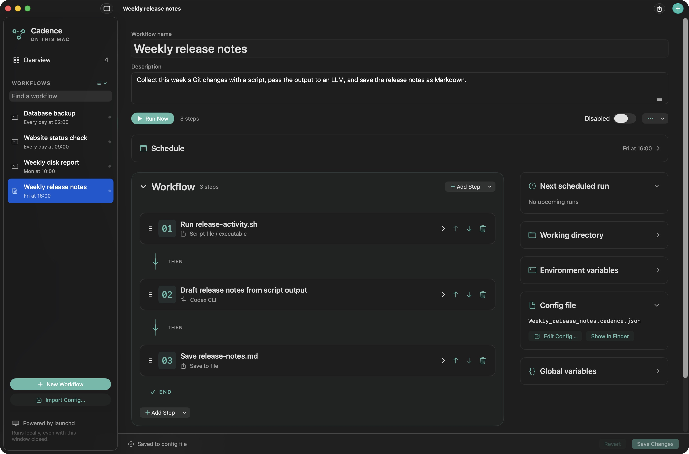

# Cadence

### Automate recurring work on your Mac with workflows - either through a GUI or a json config
Schedules local workflows with launchd. Requires macOS 14 or later. No third-party packages. 

_Most of this could be done directly with launchd if you are comfortable enough with writing those scripts but this provides a nice abstraction on top including monitoring multiple workflows, and easier visualization/debugging._

*Demo workflow: run a script to collect Git changes → draft release notes with an LLM → save the Markdown file. All workflows shown are fictional.*

## What it can do
- Put routine work on a schedule on your mac
- Connect and chain several actions like running scripts, LLM prompts (cloud or local), CLI commands, user inputs, alerts and so on
- Run steps only when certain conditions are met
- Control what happens if your Mac wasn't on at a time when a workflow was supposed to be run
- Monitor a log of previous runs, Which actions were performed, their statuses, and their outputs
- 

## Some stuff I personally use it for
- Run a daily script that looks for available slots at my local tennis centre according to my preferences, and send me an alert iff there's a new one available to book
- A daily call to a local LLM that keeps my Downloads directory organised according to a specific structure 

## Create your first workflow

It should be fairly intuitive to use but if not here's a simple walkthrough:

Open **Cadence.app** from Finder:

1. Press **⌘N** to create a workflow and give it a name.
2. Add the steps you want it to perform, in order. Choose a working directory if your workflow needs a particular folder.
3. Set when it should run.
4. Choose **Save Changes** (⌘S), then **Run Now** to try it.
5. Check the result in the workflow’s run history. When you are ready, enable the schedule and save your changes.

New workflows start paused, so you can set them up and test them before scheduling them. You can run a paused workflow manually at any time.

To use AI steps, you will need either an installed and signed-in Codex CLI or a running local model server, such as Ollama or LM Studio, with a model available.

## Limitations
- Enabled schedules keep running after you close or quit Cadence, while you are logged in. Your Mac needs to be awake to run workflows; Cadence cannot wake it. You can choose whether missed runs should be skipped or caught up when your Mac is available again. Workflows that ask for input need you to respond before they can continue (unless you specify otherwise).

- Keep the app in a stable location once you enable schedules. If you move it, open the new copy and use **Repair Schedule** on each enabled workflow.

## Other useful capabilities
- Enable or disable a workflow with a simple toggle
- Each workflow keeps a run history with its status, step results, and logs. Use it to review output or investigate a failure, then run the workflow again when needed
- Workflow definitions and run history are stored locally on your Mac. AI steps send their prompts and any included results to the tool or server you choose.
- Workflows don't need to start in the UI. You can import a JSON config to create a new workflow. This lets even LLMs take on the ffort of creating the workflow for you.

For more advanced setup, see the [config guide and examples](docs/flow-config.md). 
You can also give an AI assistant the [config-writing guide](README-for-LLMs.md) to help create or edit a workflow.
